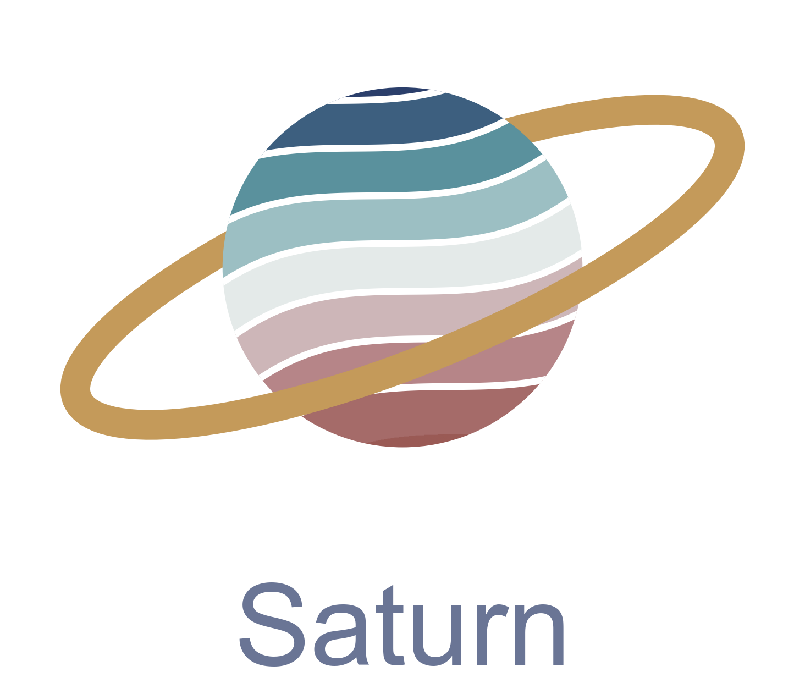
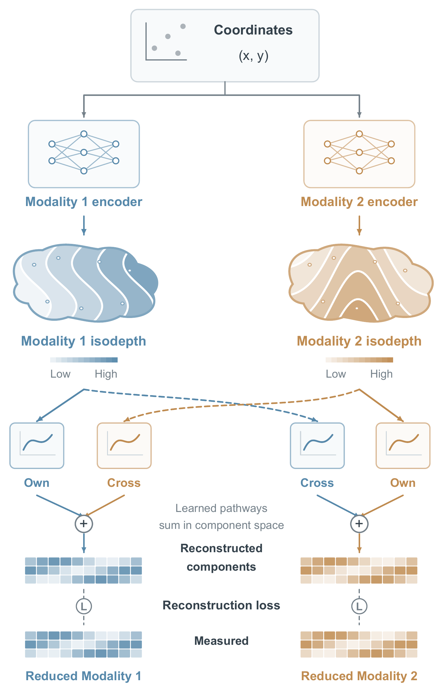

<div align="center">


**Learning comprehensive and interpretable multimodal tissue regulation topology**

---

<p align="center">
  <a href="https://c0nc.github.io/Saturn/">Documentation</a> ·
  <a href="https://c0nc.github.io/Saturn/tutorials/index.html">Tutorials</a> ·
  <a href="https://c0nc.github.io/Saturn/api/index.html">API</a>
</p>

</div>

Spatial multi-omics technologies measure several molecular layers at the same tissue locations, but turning these
data into biological insight remains hard. Most current methods learn one integrated embedding of all modalities, which
limits interpretability.

Saturn instead learns **one interpretable isodepth per modality**: a one-dimensional coordinate that describes the
dominant spatial variation of that modality, which maps directly back to its input features. Saturn extends the isodepth
concept of GASTON to spatial multi-omics. It assumes that the observed spatial pattern of each modality is the joint effect
of the isodepths of all modalities: gene expression, for example, is modelled from both the RNA isodepth and the ATAC
isodepth. An isodepth describes only the dominant variation of its modality, so the variation contributed by the other
modality is needed to model the full observation.

<p align="center">
  
</p>

## What Saturn does

- **Explore a dataset without prior knowledge:** per-modality isodepths and spatial domains, from any spatial multi-omics platform.
- **Separate own and cross contributions:** how much of each modality follows its own isodepth and how much follows another modality's.
- **Continue with downstream analysis along the isodepth:** TF activity, spatial gradients of cell-cell communication,
  Granger causality, cell-fate transition probabilities and spatial heterogeneity of isoform usage.

Saturn was applied to these datasets in the manuscript:

| dataset | modalities |
|---|---|
| Simulation benchmark | RNA + ATAC |
| LPC lesion, mouse brain (DBiT ARC-seq) | RNA + ATAC |
| Melanoma (DBiT) | RNA + ATAC |
| Mouse brain (RT&T-AMP-MERFISH) | RNA + isoform usage |
| Human tonsil (Sprox-seq) | RNA + protein, with protein complexes held out |
| Melanoma (spatial Hi-C-RNA) | RNA + Hi-C |

## Getting started

Please refer to the tutorials:

- [LPC lesion, RNA + ATAC](docs/tutorials/tutorial_lpc_rna_atac.ipynb)
- [Mouse brain MERFISH, RNA + isoform usage](docs/tutorials/tutorial_merfish_isoform.ipynb)
- [Human tonsil Sprox-seq, RNA + protein, cell-cell contact complexes](docs/tutorials/tutorial_sproxseq_rna_protein.ipynb)

The full guide is in the [documentation](https://c0nc.github.io/Saturn/). Each manuscript figure can be rerun from
[`reproducibility/`](reproducibility/README.md).

## Installation

```bash
conda create -n saturn python=3.10 -y && conda activate saturn
pip install torch --index-url https://download.pytorch.org/whl/cpu
git clone https://github.com/C0nc/Saturn.git && cd Saturn
pip install -e ".[all]"
```

## Citation

Manuscript in preparation.

## Contribution

If you found a bug or want to propose a new feature, please use the [issue tracker](https://github.com/C0nc/Saturn/issues).

## License

MIT
